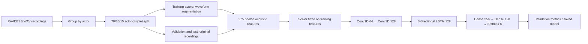

# Speech Emotion Recognition

An eight-class speech emotion classifier built with a CNN–BiLSTM and the RAVDESS audio-speech dataset. This project focuses on speaker-independent evaluation, leakage-aware preprocessing, and controlled validation experiments.

> **Evaluation note:** The reported multi-seed results below are validation macro F1 scores on one fixed actor-disjoint split. They are not test metrics. A historical test report (40.42% accuracy; 0.3948 macro F1) was exposed by an earlier smoke test and is retained only as historical context; it is not an untouched final benchmark and was not used for model selection.

## What the project does

- Extracts 275 pooled acoustic features from each recording: MFCCs and their deltas, chroma, Mel energy, spectral contrast, Tonnetz, zero-crossing rate, and RMS energy.
- Splits recordings by actor before generating training augmentation, keeping each speaker entirely within one split.
- Fits feature scaling on training data only.
- Trains a 405,128-parameter Conv1D–BiLSTM classifier with dropout, class weighting, optional training-only Mixup, early stopping, and learning-rate scheduling.
- Saves checkpoints, training curves, reports, and controlled experiment records locally.

The classes are Neutral, Calm, Happy, Sad, Angry, Fearful, Disgust, and Surprised.

## Architecture

Editable Mermaid source: [`docs/architecture.mmd`](docs/architecture.mmd).



The implementation is in [`src/feature_extraction.py`](src/feature_extraction.py), [`src/data_loader.py`](src/data_loader.py), [`src/model.py`](src/model.py), and [`src/train.py`](src/train.py).

## Dataset

Download the RAVDESS audio-speech dataset separately and place the extracted actor folders under `data/ravdess/`. The extraction code searches recursively for `.wav` files. The dataset is not included in this repository.

The default split uses 16 training actors, 4 validation actors, and 4 test actors (960/240/240 original recordings). It is actor-disjoint, with the split created before augmentation. Augmented examples are generated only for training actors. Validation and test use original recordings; the scaler is fitted only on training features. The test split is not part of model selection.

## Setup

The project was run with Python 3.11.9 and TensorFlow 2.21.0. On native Windows, this TensorFlow setup is CPU-only; use WSL2 if you need TensorFlow's supported CUDA GPU workflow. Dependency versions are recorded in [`requirements.txt`](requirements.txt).

```bash
python -m venv .venv
```

Activate the environment, then install dependencies:

```powershell
# Windows PowerShell
.venv\Scripts\Activate.ps1
python -m pip install --upgrade pip
python -m pip install -r requirements.txt
```

```bash
# macOS / Linux
source .venv/bin/activate
python -m pip install --upgrade pip
python -m pip install -r requirements.txt
```

Put RAVDESS audio under `data/ravdess/` before extracting features.

## Run the pipeline

```bash
# Build or validate the feature cache, train, and evaluate the held-out split
python main.py

# Force feature re-extraction and cache regeneration
python main.py --force-extract

# Optional arguments
python main.py --data-dir data/ravdess --epochs 30 --batch-size 32
```

**The full pipeline command evaluates the held-out test split.** The test set has historical exposure in this project's development, so its resulting score should not be described as an untouched benchmark. The paired experiment runner below is validation-only.

For one WAV prediction after training, use the saved model and matching scaler:

```bash
python -m src.predict path/to/recording.wav --model-path outputs/full_run/models/best_model.keras --scaler-path models/scaler.pkl
```

The model/scaler paths must exist. The pipeline saves its checkpoint and diagnostics under `outputs/full_run/`.

## Controlled validation experiment

Six trainings compared Mixup with no-Mixup on the same schema-v3 cache and fixed 16/4/4 actor split. Within each seed pair, architecture, class weights, optimizer, and settings were held constant; Mixup was the only change. Seeds were 42, 43, and 44. The comparison metric was validation macro F1. The runner reads the validation arrays for scoring and records that the test split was not evaluated or used for selection.

| Seed | Mixup validation macro F1 | No-Mixup validation macro F1 | Difference (Mixup − No-Mixup) |
|---:|---:|---:|---:|
| 42 | 0.4431 | 0.4172 | +0.0259 |
| 43 | 0.3887 | 0.3926 | −0.0039 |
| 44 | 0.4152 | 0.3702 | +0.0450 |
| **Mean paired change** |  |  | **+0.0223** |

Mixup had the higher score in 2 of 3 seeds, with a mean paired improvement of +0.0223 macro F1. The comparison uses three training seeds on one fixed actor split; it does not establish broad generalization. The retained Mixup baseline was not replaced.

The exact results and run metadata are in [`outputs/paired_seed_experiments/20261102-225131/results.json`](outputs/paired_seed_experiments/20261102-225131/results.json). Detailed protocol and earlier controlled comparisons are in [`outputs/full_run/experiment_notes.md`](outputs/full_run/experiment_notes.md). To rerun the paired experiment on the existing cache:

```bash
python run_paired_seed_experiments.py
python run_paired_seed_experiments.py --seeds 42 43 44
```

Each invocation creates a new timestamped output directory and does not score the test split. The earlier single-seed runner is `python run_validation_experiments.py`; it also writes separate candidate outputs.

## Artifacts and repository layout

```text
.
├── main.py
├── run_paired_seed_experiments.py
├── run_validation_experiments.py
├── requirements.txt
├── src/                         # Feature extraction, data prep, model, training, evaluation, inference
├── tests/                       # Actor-split/cache and seed-control regression tests
├── docs/
│   ├── architecture.mmd         # Editable architecture diagram
│   └── interview_notes.md       # Interview explanation and questions
├── data/                        # Local dataset and generated feature cache
├── models/                      # Local legacy/default model and scaler files
├── plots/                       # Local legacy plots
└── outputs/
    ├── full_run/                # Retained baseline, historical report, plots, experiment notes, resume entry
    ├── experiments/             # Earlier controlled validation runs
    └── paired_seed_experiments/ # Paired multi-seed validation score records
```

Model files, feature arrays, logs, and plots are local generated artifacts; they are not included in the tracked source tree by default. Only small experiment JSON and Markdown records are included; audio, feature caches, logs, plots, and model checkpoints remain local.

## Tests

Run the seven regression tests from the repository root:

```bash
python -m unittest discover -s tests -v
```

They cover actor-disjoint splitting, cache integrity, CNN input reshaping, train-only scaler fitting, explicit seed propagation, and repeatable Mixup generation.

## Limitations

- RAVDESS is small (24 actors, 1,440 speech recordings); scores can depend heavily on which four actors are held out.
- The six-run comparison uses one fixed actor split and three training seeds; it does not establish broad generalization.
- The historical test report is exposed and cannot serve as a clean final benchmark. A fresh, untouched test set or a pre-registered repeated actor-grouped evaluation is needed for that claim.
- Softmax confidence is not a calibrated probability of a person's true emotional state. Speech emotion labels are also context-dependent.
- Native Windows TensorFlow 2.21.0 ran on CPU in the recorded environment.

## Resume entry and interview preparation

See [`outputs/full_run/resume_entry.md`](outputs/full_run/resume_entry.md) for a concise, evidence-based resume version and [`docs/interview_notes.md`](docs/interview_notes.md) for an explanation and technical Q&A.

## Technologies

Python, TensorFlow/Keras, Librosa, NumPy, scikit-learn, Matplotlib, Seaborn, and Joblib.

